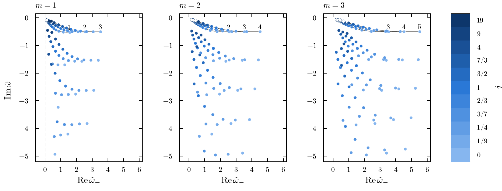

<!-- Authors: Mark Essa Sukaiti, Davide Batic and Dr. Denys Dutykh (Mathematics Department, Khalifa University of Science and Technology, Abu Dhabi, UAE) -->

# wormhole-qnm-chebyshev-2d: scalar quasinormal modes of the exact spinning Morris–Thorne wormhole



The converged quasinormal frequencies of a massless scalar field on the exact spinning Morris–Thorne wormhole, for the azimuthal numbers m = 1, 2 and 3 (one panel each), in units of the throat radius r₀ and in the frame of the second exterior, ω̂₋ = r₀ω − 3πmj, coloured by the dimensionless angular momentum j = J/r₀² from 0 to 19. Each spectrum is mirror symmetric about Re ω̂ = 3πmj/2, and only its half with Re ω̂ ⩾ 3πmj/2 is drawn. The thin lines follow the fundamental modes of the multipoles L = m, m + 1 and m + 2 (labelled at j = 0) as the spin grows, and the open circles are fundamental modes taken from the continuation in μ = mj by direct integration, at the spins where the spectral solver did not resolve them. Every frequency is damped, and as j grows the fundamental modes approach the dashed line Re ω̂₋ = 0, the upper edge of the superradiant window. This is the first figure of the preprint, drawn by `Julia/RotatingWormhole/make_figures.jl`.

These codes compute the quasinormal modes of a massless scalar field on the complete two-ended geometry of the exact spinning Morris–Thorne wormhole, whose two asymptotic rest frames rotate relative to each other. After the behaviour on the axis and the outgoing phases at both infinities are extracted, the radial coordinate is compactified and the problem becomes a quadratic eigenvalue problem, discretised by two-dimensional Chebyshev collocation: the collocation matrices are assembled in Maple, and the eigenvalue problems are solved, filtered and analysed in Julia, with direct integration of the radial equation as an independent check. The same solver is validated on the Kerr spacetime. The codes accompany the preprint by Mark Sukaiti, Davide Batic and Denys Dutykh, "Scalar quasinormal modes of the exact spinning Morris–Thorne wormhole" (arXiv:2611.12838, 2026), which has been submitted for publication.

## Contents

```text
Maple/
  RotatingWormhole/   MatrixGenerator.mw     collocation matrices of the wormhole pencil (Sec. III)
                      MyExploration.mw       derivation of the compactified operator (Sec. II)
  Kerr/               MatrixGenerator_Nu.mpl collocation matrices of the Kerr pencil (Sec. V)
                      MyExploration.mw       derivation of the Kerr operator coefficients
Julia/
  Project.toml, Manifest.toml                package environment for all Julia scripts
  RotatingWormhole/   spectral solver, post-processing, direct integration, tables, figures
  Kerr/               spectral solver, comparison with continued-fraction and published values
    reference/        qnm-package reference values and published values used in Sec. V
docs/figures/         the figure of this page, a PNG image of Julia/RotatingWormhole/plots/spectra_overview.pdf
```

The sections, tables and figures named here are those of the preprint. Each folder under `Julia/` has its own README, which gives the order in which its scripts are run and the section, table or figure that each one produces; `Maple/README.md` describes the worksheets and says where their matrices must go.

## Requirements

The matrices are assembled with Maple (the worksheets use the packages LinearAlgebra and ExportMatrix). The Julia scripts need Julia 1.10 or later; from the folder `Julia/`, the command `julia --project=. -e 'using Pkg; Pkg.instantiate()'` installs Arblib, DoubleFloats, GenericSchur, OrdinaryDiffEqHighOrderRK, Plots and LaTeXStrings, and every script is then run with `julia --project=..` from its own folder, with `-t <threads>` where the folder's README says so. Python 3 with the `qnm` package is needed only to compute the Kerr reference values again (`Julia/Kerr/reference/qnm_reference.py`); their output is stored, so Python is not needed otherwise. The package is available at

https://github.com/duetosymmetry/qnm

## Conventions

For the wormhole, the frequency is ω̂ = r₀ω (written `w` in the code), the spin is j = J/r₀², and ω̂₋ = ω̂ − 3πmj is the frequency in the frame of the second exterior. The spin tags k = 0, …, 10 in the file names encode j* = k/10 (with j* = 0.95 for k = 10) and j = j*/(1 − j*), so that j runs over 0, 1/9, 1/4, 3/7, 2/3, 1, 3/2, 7/3, 4, 9 and 19. For Kerr, the matrices and the solver use units with 2M = 1, and the analysis scripts report Mω; the spin tags k = 0, …, 9 are a/M = k/10, and k = 10 is a/M = 0.99. The time dependence is exp(−iωt), so that damped modes have Im ω < 0.

## Size of the intermediate data

The wormhole matrices, in 200-digit arithmetic, take about 2.5 GB per azimuthal sector and are not stored here; the Maple worksheet generates them. The output of the solver (raw spectra and convergence diagnostics, about 14 MB per sector) is the input of all the scripts that analyse it.

## Reproducing the preprint

The matrices come first: `Maple/RotatingWormhole/MatrixGenerator.mw` is run for the wormhole (m = 1, 2, 3) and `Maple/Kerr/MatrixGenerator_Nu.mpl` for Kerr, and `Maple/README.md` says where the exported matrices must go for the Julia solvers. The spectra follow: `Julia/RotatingWormhole/QNMThreads.jl` (once per sector, with `QNM_M=<m>`) and `Julia/Kerr/QNMThreads_Nu.jl` solve the pencils at three resolutions and write the raw spectra and the convergence diagnostics. Last come the analysis, the tables and the figures, by the remaining scripts in the order given in `Julia/RotatingWormhole/README.md` and `Julia/Kerr/README.md`.

The first two steps are the expensive ones. The folders `results/` already contain the output of the analysis scripts for the runs reported in the preprint (converged modes, rejected roots, the continuation in μ = mj, the eigenvalues of the limit problem, the Kerr comparisons, and the LaTeX tables), and `Julia/RotatingWormhole/plots/` contains its four figures, so that most results can be checked without running the solver again.

## How to cite

If you use these codes, please cite the preprint:

M. Sukaiti, D. Batic and D. Dutykh, Scalar quasinormal modes of the exact spinning Morris–Thorne wormhole, arXiv:2611.12838 (2026), submitted.

https://doi.org/10.48550/ARXIV.2611.12838

```bibtex
@misc{Sukaiti2026a,
  author = {Sukaiti, Mark and Batic, Davide and Dutykh, Denys},
  title = {Scalar Quasinormal Modes of the Exact Spinning {{Morris}}--{{Thorne}} Wormhole},
  year = 2026,
  publisher = {arXiv},
  doi = {10.48550/ARXIV.2611.12838}
}
```

The button "Cite this repository" in the right-hand column of this page gives the same reference, read from `CITATION.cff`. The preprint refers to the original repository of Mark Sukaiti, of which this one is a copy:

https://github.com/MarkSukaiti/wormhole-qnm-chebyshev-2d

The background geometry is constructed in the article D. Batic, D. Dutykh and M. E. Sukaiti, Exact spinning Morris–Thorne wormhole: causal structure, shadows, and multipole moments, The European Physical Journal C 86, 179 (2026).

https://doi.org/10.1140/epjc/s10052-026-15354-3

```bibtex
@article{Batic2026a,
  author = {Batic, Davide and Dutykh, Denys and Sukaiti, Mark Essa},
  title = {Exact Spinning {{Morris-Thorne}} Wormhole: Causal Structure, Shadows, and Multipole Moments},
  journal = {The European Physical Journal C},
  year = 2026,
  month = feb,
  volume = {86},
  number = {2},
  pages = {179},
  doi = {10.1140/epjc/s10052-026-15354-3},
  eprint = {2602.21906},
  archiveprefix = {arXiv}
}
```

## Licence

GNU Affero General Public License, version 3 (see `LICENSE`).
